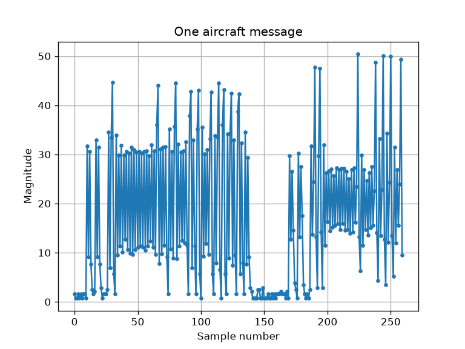

# Pi Ground Station: ADS-B Receiver from Raw I/Q

A software-defined receiver for aircraft ADS-B (Automatic Dependent Surveillance-Broadcast)
broadcasts at 1090 MHz, written from scratch: first as a Python prototype, then as a C++
implementation running on a Raspberry Pi 4B.

It takes raw I/Q samples from an RTL-SDR recording and turns them into readable flight
information: aircraft identity, callsign, altitude, speed, heading and position.

No SDR or ADS-B decoding libraries are used. Every step, from pulse detection to
position decoding, is implemented in this repository.

```
ICAO    Callsign   Alt(ft) Spd(kt)    Hdg     V/S  Msgs  Position
4D2023  AMC421       20025     371  158.0   -1728   141  36.9563° N, 13.8583° E

Aircraft seen: 1
```

*Output of the C++ receiver on the reference recording: Air Malta flight AMC421,
descending south of Sicily on approach to Malta.*

---

## How it works



The receiver is a chain of small, separately tested steps:

| Step | What it does |
|---|---|
| **1. Signal strength** | Converts 8-bit unsigned I/Q samples (2 MS/s) into magnitude, √(I² + Q²). |
| **2. Preamble detection** | Slides a 4-pulse template (pulses at 0, 1, 3.5 and 4.5 µs) along the signal to find where each message starts. |
| **3. Demodulation** | Reads pulse-position modulated (PPM) bits: a pulse in the first half of each 1 µs slot is a 1, in the second half a 0. |
| **4. Message type** | Reads the 5-bit Downlink Format (DF) and keeps DF 17 (ADS-B) messages. |
| **5. Error checking** | Validates each 112-bit message with the Mode S CRC-24 (generator 0x1FFF409), rejecting corrupted messages and false detections. |
| **6. Decoding** | Extracts the ICAO address, callsign, barometric altitude, velocity and CPR-encoded position. |
| **7. Aircraft table** | Groups messages by ICAO address and keeps the latest state of every aircraft. |

### Position decoding (CPR)

ADS-B packs each position into only 17 bits of latitude and 17 bits of longitude using
Compact Position Reporting. Each message gives the aircraft's position *within* a zone,
not which zone it is in. Aircraft alternate between two grids of slightly different
zone sizes (even and odd messages). Combining one of each, like reading a vernier
scale, identifies the zone and gives the full position. The number of longitude zones
depends on latitude (NL), which is handled as defined in the standard. A position is
only accepted when both messages agree on NL, so a pair that straddles a zone boundary
is discarded instead of giving a wrong fix.

### Verification

Independent parts of the decoder are checked against each other:

- **Heading vs. track:** the heading decoded from velocity messages (157.8°) matches the
  direction of the path traced by the decoded positions (158.0°).
- **Vertical speed vs. altitude:** the decoded descent rate (about −1,700 to −1,900 ft/min)
  is consistent with the altitude change across the recording (≈ 24,000 → 20,000 ft).
- **Reference message:** the decoder reproduces the known callsign of the standard
  example message `8D4840D6202CC371C32CE0576098` (KLM1023).
- **Python vs. C++:** the C++ receiver was checked stage by stage against the Python
  prototype (sample count, preamble candidates, valid messages, every decoded field)
  and produces identical results.

---

## ADS-B message format (reference)

Bit numbers below start at 0 and are inclusive (bits 8–31 = 24 bits), the same
numbering the code uses.

### On the air

- **Frequency:** 1090 MHz
- **Modulation:** pulse-position modulation (PPM), 1 Mbit/s. Each bit is a 1 µs slot:
  pulse in the first half = 1, pulse in the second half = 0.
- **Preamble:** 8 µs, pulses at 0, 1, 3.5 and 4.5 µs. At 2 MS/s that is 16 samples,
  with high samples at 0, 2, 7, 9.
- **Message:** 112 bits (long, ADS-B) or 56 bits (short, other Mode S replies),
  starting right after the preamble.

### Message layout (112 bits)

| Bits    | Field | Meaning |
|---------|-------|---------|
| 0–4     | DF    | Downlink Format. 17 = ADS-B |
| 5–7     | CA    | Transponder capability |
| 8–31    | ICAO  | 24-bit aircraft address, unique per airframe (shown as 6 hex digits) |
| 32–87   | ME    | 56-bit payload. Its first 5 bits are the Type Code |
| 88–111  | PI    | 24-bit CRC parity |

### Type Code (bits 32–36)

| TC    | Message |
|-------|---------|
| 1–4   | Aircraft identification (callsign) |
| 5–8   | Surface position |
| 9–18  | Airborne position, barometric altitude |
| 19    | Airborne velocity |
| 20–22 | Airborne position, GNSS height |
| 23–31 | Status and other messages (not decoded here) |

### Identification (TC 1–4)

| Bits  | Field |
|-------|-------|
| 37–39 | Aircraft category |
| 40–87 | Callsign: 8 characters × 6 bits |

Each 6-bit value is a position in the lookup table
`#ABCDEFGHIJKLMNOPQRSTUVWXYZ##### ###############0123456789######`:
1–26 → A–Z, 32 → space, 48–57 → 0–9. Trailing spaces are padding.

### Airborne position (TC 9–18)

| Bits  | Field |
|-------|-------|
| 37–38 | Surveillance status |
| 39    | Single antenna flag |
| 40–51 | Altitude (12 bits, Q bit at 47) |
| 52    | Time flag |
| 53    | CPR format: 0 = even, 1 = odd |
| 54–70 | CPR latitude (17 bits) |
| 71–87 | CPR longitude (17 bits) |

- **Altitude:** if Q (bit 47) = 1, remove it to get an 11-bit number N.
  Altitude = 25 × N − 1000 ft. (Q = 0 is an older Gillham encoding, not decoded here.)
- **CPR fractions:** latitude and longitude values ÷ 131072 (2¹⁷) give fractions from 0 to 1.

### Airborne velocity (TC 19, subtypes 1–2: ground speed)

| Bits  | Field |
|-------|-------|
| 37–39 | Subtype |
| 40    | Intent change flag |
| 41    | IFR capability flag |
| 42–44 | Velocity uncertainty (NUCr) |
| 45    | East–west direction: 0 = east, 1 = west |
| 46–55 | East–west speed + 1 (knots) |
| 56    | North–south direction: 0 = north, 1 = south |
| 57–66 | North–south speed + 1 (knots) |
| 67    | Vertical rate source (GNSS / baro) |
| 68    | Vertical rate sign: 0 = up, 1 = down |
| 69–77 | Vertical rate: (value − 1) × 64 ft/min |
| 78–79 | Reserved |
| 80    | GNSS minus baro altitude, sign |
| 81–87 | GNSS minus baro altitude, value |

- **Speed** = √(east² + north²), with west and south taken as negative.
- **Heading** = atan2(east, north), converted to degrees, 0–360 clockwise from north.
- A speed or rate field of 0 means "not available".

### CPR position (one even + one odd message)

```
j      = floor(59 × lat_even − 60 × lat_odd + 0.5)
lat_e  = 6 × ((j mod 60) + lat_even)                  (360/60 = 6° zones)
lat_o  = (360/59) × ((j mod 59) + lat_odd)
         if a latitude ≥ 270, subtract 360

NL(lat) = floor(2π / acos(1 − (1 − cos(π/30)) / cos²(lat)))
          special cases: lat = 0 → 59, |lat| = 87 → 2, |lat| > 87 → 1
          NL(lat_e) must equal NL(lat_o), otherwise discard the pair

k      = floor((NL − 1) × lon_even − NL × lon_odd + 0.5)
lon    = (360/NL) × ((k mod NL) + lon_even)
         if lon ≥ 180, subtract 360
```

`mod` here is always 0 to n−1, even for negative numbers (Python's `%`, not C's `%`).

### CRC-24

Generator polynomial `0x1FFF409` (25 bits: `1111111111111010000001001`). Long division
(XOR) over the first 88 bits. A valid message leaves a remainder of 0 in the last 24 bits.

### Worked example

`8D4840D6202CC371C32CE0576098`

| Part | Hex / bits | Value |
|------|------------|-------|
| DF, CA | `8D` = `10001 101` | DF 17 (ADS-B), CA 5 |
| ICAO | `4840D6` | aircraft 4840D6 |
| ME | `202CC371C32CE0` | TC = `00100` = 4 → identification, callsign KLM1023 |
| PI | `576098` | CRC parity (checks out) |

---

## Performance

Decoding `modes1.bin` (356,868 samples = 0.178 s of radio at 2 MS/s) on a Raspberry Pi.
All three versions produce the same output.

| Version    | Time (best / typical) | Real-time factor | Live capable? |
|------------|-----------------------|------------------|---------------|
| Python     | 2.14 s                | 0.08×            | No            |
| C++, `-O0` | 0.198 s               | 0.9×             | No            |
| C++, `-O2` | 0.058 s / 0.120 s     | 3.1× / 1.5×      | Yes           |

Real-time factor = signal duration ÷ decode time. Above 1 means the decoder keeps up
with a live 2 MS/s stream.

- The C++ receiver is about 18–37× faster than the Python prototype.
- Compiler optimisation (`-O2`) alone gives a 1.7–3.4× speed-up, enough to cross the
  real-time line.
- The spread in the `-O2` timings comes from CPU frequency scaling on the Pi: short runs
  can finish before the CPU has ramped up to full clock speed.

---

## Running it

The recordings are not stored in this repo. Download the reference recording
`modes1.bin` from the `testfiles` folder of
[antirez/dump1090](https://github.com/antirez/dump1090) and place it in `recordings/`.

Recordings are raw RTL-SDR captures: unsigned 8-bit I/Q, interleaved, 2 MS/s, tuned to
1090 MHz.

### C++ receiver (Raspberry Pi or any Linux machine)

Requirements: `g++`.

```bash
cd cpp
g++ -O2 -Wall -o adsb src/*.cpp
./adsb ../recordings/modes1.bin
```

### Python prototype

Requirements: Python 3, NumPy, Matplotlib.

```bash
pip install numpy matplotlib
cd python
python adsb_decoder.py
```

---

## Project structure

```
pi-groundstation/
├── cpp/
│   └── src/
│       ├── main.cpp         # load → find messages → update aircraft → print table
│       ├── recording.*      # read a raw I/Q recording into memory
│       ├── signal.*         # I/Q to magnitude
│       ├── preamble.*       # preamble detection
│       ├── bits.*           # PPM demodulation, bit-field extraction
│       ├── crc.*            # Mode S CRC-24 check
│       ├── decode.*         # ICAO, callsign, altitude, velocity, CPR position
│       └── aircraft.*       # per-aircraft state and the output table
├── python/
│   ├── adsb_decoder.py      # the Python prototype
│   └── step*.py             # early exploration scripts (signal plots, first decoding steps)
├── docs/                    # images for this README
└── recordings/              # I/Q recordings (not tracked by git)
```

---

## Roadmap

- [x] ADS-B receiver in Python: detection, demodulation, CRC, full message decoding
- [x] C++ receiver on Raspberry Pi, verified against the Python prototype, 3× real time
- [ ] Profile and optimise the C++ receiver stage by stage
- [ ] Real-time streaming receiver (multithreaded, ring buffer)
- [ ] Live reception with an RTL-SDR dongle
- [ ] Meteor-M weather satellite receiver (QPSK demodulation, carrier and timing recovery, Viterbi and Reed-Solomon decoding)
- [ ] Custom Yocto image so the Pi boots straight into the ground station

---

## References

- Junzi Sun, *The 1090 MHz Riddle*, [mode-s.org/decode](https://mode-s.org/decode/): Mode S and ADS-B message formats, CRC and CPR
- [antirez/dump1090](https://github.com/antirez/dump1090): source of the reference recording