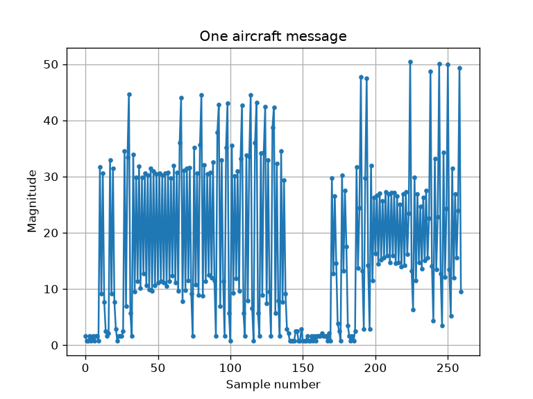

# Pi Ground Station: ADS-B Receiver from Raw I/Q

A software-defined receiver for aircraft ADS-B (Automatic Dependent Surveillance-Broadcast) 
broadcasts at 1090 MHz, written from scratch.
It takes raw I/Q samples from an RTL-SDR recording and turns them into live flight
information: aircraft identity, callsign, altitude, speed, heading and position.

No SDR or ADS-B decoding libraries are used. Every step, from pulse detection to
position decoding, is implemented in this repository.

```
ICAO    Callsign    Altitude   Speed  Heading     V/S   Position                     Msgs
----------------------------------------------------------------------------------------
4D2023  AMC421         20025     371    158.0   -1728   36.9563° N, 13.8583° E        141
```

*Output on the reference recording: Air Malta flight AMC421, descending south of Sicily
on approach to Malta.*

---

## How it works



The receiver is a chain of small, separately tested steps:

| Step | What it does |
|---|---|
| **1. Signal strength** | Converts 8-bit unsigned I/Q samples (2 MS/s) into magnitude, √(I² + Q²). |
| **2. Preamble detection** | Slides a 4-pulse template (pulses at 0, 1, 3.5 and 4.5 µs) along the signal to find where each message starts. |
| **3. Demodulation** | Reads pulse-position modulated (PPM) bits: a pulse in the first half of each 1 µs slot is a 1, in the second half a 0. |
| **4. Message type** | Reads the 5-bit Downlink Format (DF) and keeps DF 17 (ADS-B) messages. |
| **5. Error checking** | Validates each 112-bit message with the Mode S CRC-24 (generator 0x1FFF409), rejecting corrupted messages and false detections. |
| **6. Decoding** | Extracts the ICAO address, callsign, barometric altitude, velocity and CPR-encoded position. |
| **7. Aircraft table** | Groups messages by ICAO address and keeps the latest state of every aircraft. |

### Position decoding (CPR)

ADS-B packs each position into only 17 bits of latitude and 17 bits of longitude using
Compact Position Reporting. Each message gives the aircraft's position *within* a zone,
not which zone it is in. Aircraft alternate between two grids of slightly different
zone sizes (even and odd messages). Combining one of each, like reading a vernier
scale, identifies the zone and gives the full position. The number of longitude zones
depends on latitude (NL), which is handled as defined in the standard.

### Verification

Independent parts of the decoder are checked against each other:

- **Heading vs. track:** the heading decoded from velocity messages (157.8°) matches the
  direction of the path traced by the decoded positions (158.0°).
- **Vertical speed vs. altitude:** the decoded descent rate (about −1,700 to −1,900 ft/min)
  is consistent with the altitude change across the recording (≈ 24,000 → 20,000 ft).
- **Reference message:** the decoder reproduces the known callsign of the standard
  example message `8D4840D6202CC371C32CE0576098` (KLM1023).

---

## Running it

Requirements: Python 3, NumPy, Matplotlib.

```bash
pip install numpy matplotlib
```

The recordings are not stored in this repo. Download the reference recording
`modes1.bin` from the `testfiles` folder of
[antirez/dump1090](https://github.com/antirez/dump1090) and place it in `recordings/`.

```bash
cd python
python adsb_decoder.py
```

Recordings are raw RTL-SDR captures: unsigned 8-bit I/Q, interleaved, 2 MS/s, tuned to
1090 MHz.

---

## Project structure

```
pi-groundstation/
├── python/
│   ├── adsb_decoder.py   # the receiver
│   └── step*.py          # early exploration scripts (signal plots, first decoding steps)
├── docs/                 # images for this README
└── recordings/           # I/Q recordings (not tracked by git)
```

---

## Roadmap

- [x] ADS-B receiver in Python: detection, demodulation, CRC, full message decoding
- [ ] Real-time C++ receiver on Raspberry Pi (streaming, multithreaded, ring buffer)
- [ ] Live reception with an RTL-SDR dongle
- [ ] Meteor-M weather satellite receiver (QPSK demodulation, carrier and timing recovery, Viterbi and Reed-Solomon decoding)
- [ ] Custom Yocto image so the Pi boots straight into the ground station

---

## References

- Junzi Sun, *The 1090 MHz Riddle*, [mode-s.org/decode](https://mode-s.org/decode/): Mode S and ADS-B message formats, CRC and CPR
- [antirez/dump1090](https://github.com/antirez/dump1090): source of the reference recording
